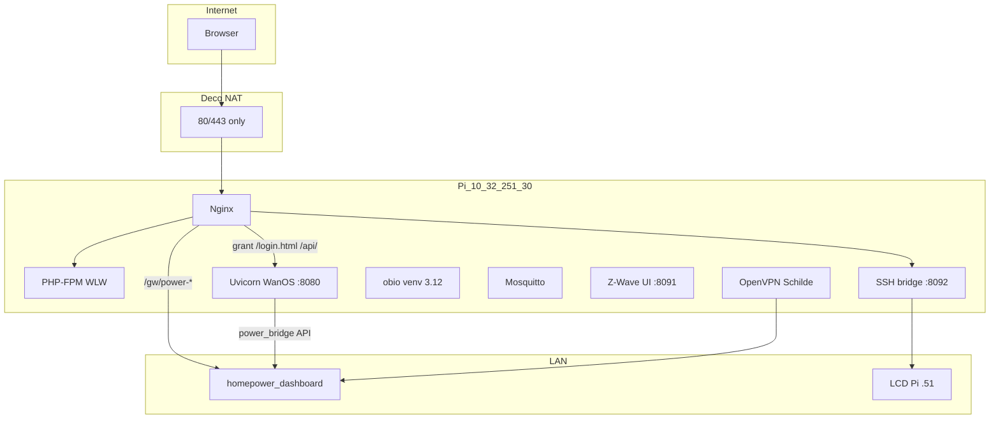

# --- file: docs/wanos-wlw-cotenancy-architecture.md ---
# WanOS + WLW co-tenancy — architecture review + optimization plan

**Status:** Analysis locked 2026-11-26 (operator request). Product reference for co-tenancy.  
**Delivery track:** Sequence **O1** (hold after Ops7) — [`todo/phaseO-optimization.md`](todo/phaseO-optimization.md) § O1 · sibling be90 [`todo/phaseO-optimization.md`](../../be90webserver/docs/todo/phaseO-optimization.md) § O1.  
**Canonical home:** this file in **wanos**.  
**Pointer:** be90webserver `docs/wanos-wlw-cotenancy-architecture.md` (sibling clone).

**Related product docs:** [`architecture.md`](architecture.md) · [`wanos-sync.md`](wanos-sync.md) · [`bootstrap-main-pi.md`](bootstrap-main-pi.md) · [`ops7-operator-checklist.md`](ops7-operator-checklist.md) · [`integration_power_bridge.md`](integration_power_bridge.md) · be90 [`architecture.md`](../../be90webserver/docs/architecture.md) · [`gateway.md`](../../be90webserver/docs/gateway.md) · [`edge.md`](../../be90webserver/docs/edge.md) · [`wlw-sync.md`](../../be90webserver/docs/wlw-sync.md) · [`bootstrap-host.md`](../../be90webserver/docs/bootstrap-host.md) · [`security.md`](../../be90webserver/docs/security.md)

---

## Verdict

Two products on **one Pi** (`10.32.251.30`) with a **correct repo split**, but a **shared edge that is more complex than either product alone**. Highest leverage is not a merge or a big rewrite: **finish Ops7 as one cutover**, then **shrink the public-edge blast radius** and keep this co-tenancy contract accurate. Sync pairing is already in good shape (P2/P3).

---

## Cross-functional map (verified)

| Surface | Owner | Coupling |
|---|---|---|
| Host OS / PHP apt / system Python / no Samba | **wanos** Ops7 | Blocks WLW **B30b** + overlay smoke |
| WLW nginx site, `/var/lib/wlw`, SSH bridge, OpenVPN | **be90webserver** overlay | Assumes host packages already present |
| Deploy PC→Pi + Pi clone→live | **wanos** `wanos-sync` + `wlw-sync.sh` | Shared `[MirrorExclude*]` SSoT; be90 has **no** sync script |
| Public HTTPS portal | WLW | Proxies WanOS, Synology, site.eu/evo, Power |
| LAN WanOS | `app.wanos.be` → `:8080` | Separate LE + vhost; must not break on WLW bootstrap |
| Auth | Separate | WanOS JWT/PIN vs WLW session/OTP/TOTP/Budget PIN; SSO deferred (N6) |
| Mail | Divergent | WLW **SMTP** App Password (`auth.md`); WanOS **E** planned **Gmail OAuth** outbox |
| Energy | Triangle | WanOS sensors + [`integration_power_bridge.md`](integration_power_bridge.md) → homepower; WLW only reverse-proxies Power tiles |
| SD / logs | Shared card | Both use WAL + log2ram discipline; sync pulls both log trees |

---

## Main architectural risks (ordered)

### 1. Public root-grant for WanOS [Certain]

WanOS is root-absolute (`/api/…`, `/*.html`). WLW cannot put it under `/gw/wanos/` without rewriting the app, so the **WanOS grant cookie is scoped to site root** (be90 `docs/gateway.md`, `helpers/bootstrap/wlw.nginx.gw.inc`). That widens cookie/path blast radius vs path-scoped backends (Power, Synology prefix).

### 2. `/api/` multiplex WanOS vs DirectAdmin evo [Certain]

Same location uses **cookie + Referer heuristics** to choose upstream (`127.0.0.1:8080` vs `da009.site.eu:2222`). Fragile under missing Referer, prefetch, or concurrent tabs. Highest accidental cross-talk risk on the shared edge. Prefer **cookie-only** routing over Referer when hardening (Referer is optional/stripped). Also: every new WanOS root-absolute HTML/API path must be listed in be90 `helpers/bootstrap/wlw.nginx.gw.inc` — drift risk as WanOS grows.

### 3. Ops7 is the shared critical path [Certain]

WanOS Sequence #1; be90 holds Ops7 + **B30b** (SQLCipher) behind it. Live host still on PHP 7.4 bridge (Ops8 Done). Cutover is the only honest unlock for PHP 8.4, Python 3.13 soak, encrypt, and cleaner package ownership (PHP apt stripped from WLW overlay). Dual LE lineages share **WanOS crontab renew** (certbot prefers `wanos_venv`) — LE failure is a shared availability risk.

### 4. Runtime sprawl on one SD [Likely]

Locked trio: `wanos_venv` (3.13), system `/usr/bin/python3` for SSH bridge, uv CPython **3.12** under `/var/lib/wlw/obio`. Plus PHP-FPM, Mosquitto, Z-Wave Docker, OpenVPN, nginx. Ops7 soak = **one load profile**. Stale comment risk: `wlw_obio_setup.sh` still mentions bridge **3.9** — contradicts Ops7. Do not add a fourth venv.

### 5. Dual outbound mail stacks [Certain / future]

WLW already sends via SMTP; WanOS **E** designs a separate OAuth spooler. Two credential stores, two failure modes, two alert paths on the same mailbox family unless deliberately unified later. Do not block Ops7/B30b on Phase E.

### 6. Residual host exposure + shared log2ram [Certain]

be90 `docs/security.md`: no INPUT firewall; Z-Wave UI `*:8091`; no portal login rate-limit (locked Out). Deco 80/443-only is the WAN control — LAN trust is broader. Shared tmpfs `SIZE=` must absorb WanOS Loguru + WLW app/nginx + system logs; chatty either side fills log2ram.

### 7. Sync is healthy — do not “optimize” it away [Certain]

Shared MirrorExclude + checksum WLW pair + pull-only `/var/lib/wlw` state is the right model. Drift risk is **process** (change config without both docs/rules), not architecture. Agent pair rule: `.cursor/rules/wlw-sync-pair.mdc` in both repos.

### 8. Pre-cutover doc drift [Certain]

be90 `docs/edge.md` still cites `php7.4-fpm.sock` while overlay targets Trixie/8.4 auto-detect. Strip Bullseye leftovers in product docs as part of Ops7 Last DoD.

---

## What is already optimized / leave alone

- Repo split (home control vs portal/budget) — keep
- Host bootstrap ownership in wanos + WLW overlay pointer (be90 `docs/bootstrap-host.md`)
- Energy product in **homepower_dashboard**, not stuffed into WLW
- Separate auth (cookie domains / product trust boundaries)
- H7/H8 SQLite + log2ram rules
- Sync exclude SSoT + Pi `wlw-sync.sh` living in wanos only

---

## Co-tenancy contract (ownership locks)

| Topic | Lock |
|---|---|
| Host flash / PHP apt / system Python / WanOS nginx baseline / no Samba | **wanos** Ops7 |
| WLW nginx site + `/var/lib/wlw` + SSH bridge + OpenVPN + budget | **be90webserver** overlay after host green |
| LE renew crontab | WanOS-owned; certbot prefers `wanos_venv` — shared availability |
| Deploy WanOS | `helpers\wanos-sync.bat test\|run` (+ pull/logcopy as needed) |
| Deploy WLW (PC) | `helpers\wanos-sync.bat … wlw` |
| Deploy WLW (Pi clone→live) | `bash ~/wanos/helpers/wlw-sync.sh` — **not** a be90 script |
| Python trio | `wanos_venv` · system python (bridge) · obio uv 3.12 — no fourth venv without assess |
| log2ram / rsyslog host | WanOS Phase 1; WLW bootstrap must **not** touch |
| Auth / SSO | Separate stores; SSO deferred |
| Mail | Separate until explicit decision before WanOS Phase **E** |

---

## Optimization roadmap (recommended order)

### Track A — Co-tenancy cutover (now)

1. Execute **wanos Ops7** per [`ops7-operator-checklist.md`](ops7-operator-checklist.md) (Z-Wave backup mandatory; `.env` offline).
2. Immediately **be90 Ops7 overlay** + restore `/var/lib/wlw` + renew `wlw_ed25519`.
3. Smoke matrix as one system: WanOS LAN, WLW public, gateway WanOS tile, evo `/api/` mux, Power BE90/Schilde, SSH bridge, budget login.
4. Only then resume **B30b**.

### Track B — Edge hygiene (after Ops7 soak)

1. Treat **`/api/` mux** as a known hazard: document failure modes; smoke rows for WanOS API with evo grant present and reverse; prefer cookie-only over Referer when changing nginx.
2. Inventory WanOS root paths listed in `wlw.nginx.gw.inc`; process rule: new WanOS HTML entrypoints require a gw.inc location.
3. Assess (do not implement yet) **reducing WanOS public surface**:
   - Prefer LAN `app.wanos.be` for day-to-day; public tile as break-glass; or
   - Longer-term WanOS relative-base / dedicated public hostname (high cost — only if corporate-proxy use of WanOS is real).
4. Avoid new root-absolute upstreams on the WLW public vhost.
5. Close **H10** (host allowlist out of git) and schedule **H6** pentest against the **combined** edge, not PHP-only.

### Track C — Keep this contract current

- Process/port ownership table (above) stays accurate after Ops7
- Strip `php7.4` / bridge `3.9` leftovers from product docs at Ops7 close-out
- Joint log2ram SIZE budget noted in Ops7 soak / host docs when re-verified

### Track D — Runtime / mail consolidation (assess only)

1. Post-Ops7: smoke bridge WSS + obio pull + WanOS UI on 3.13 host; keep obio 3.12 isolated unless pain is measured.
2. Before implementing WanOS **E**: decide SMTP-reuse vs OAuth outbox vs shared “send mail” helper — avoid two production senders by default.
3. Do **not** fold budget into WanOS or vice versa.

### Track E — Product backlog that is *not* cross-repo

Ignore for this plan: be90 **B88** FOUC, WanOS Blockly **B26/B24**, integrations **G9–G13**. They do not change co-tenancy.

---

## Explicit non-recommendations

- Merging wanos + be90webserver
- Moving sync engine into be90
- Putting WanOS under `/gw/wanos/` without a WanOS asset-base redesign
- Unifying auth/SSO before Ops7 + H6
- Adding INPUT firewall / rate-limit without a locked security phase (H track already owns residuals)

---

## Success criteria for this architecture track

- Ops7 Done in **both** pipelines with combined smoke
- This co-tenancy doc kept accurate; be90 pointer stays valid
- Documented `/api/` mux failure cases + operator smoke
- Conscious mail decision recorded before WanOS **E** coding
- H6 scoped to “portal + proxied WanOS + gateway”, not app-only
